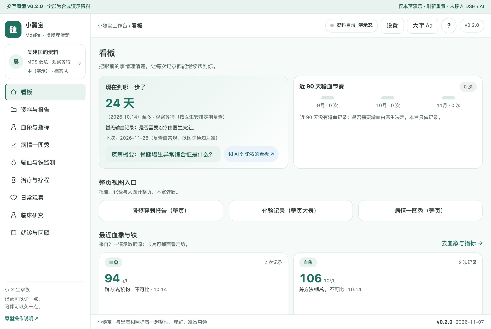
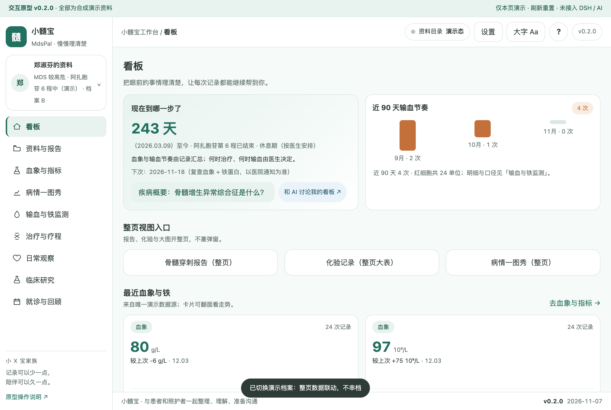
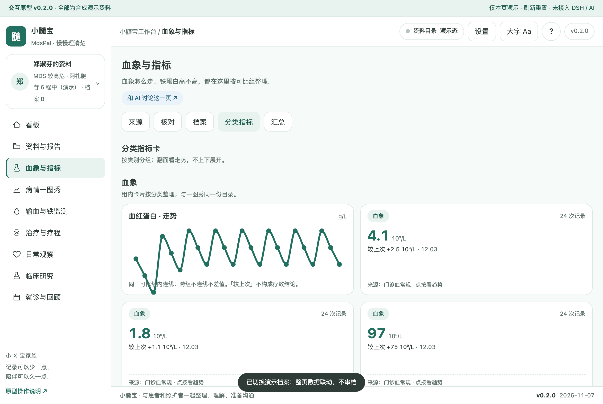
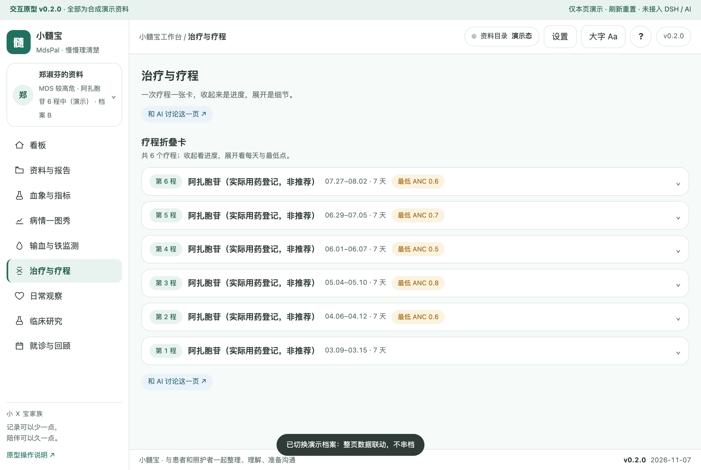
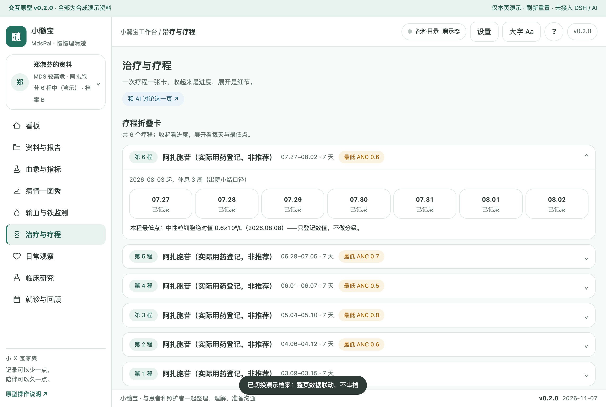
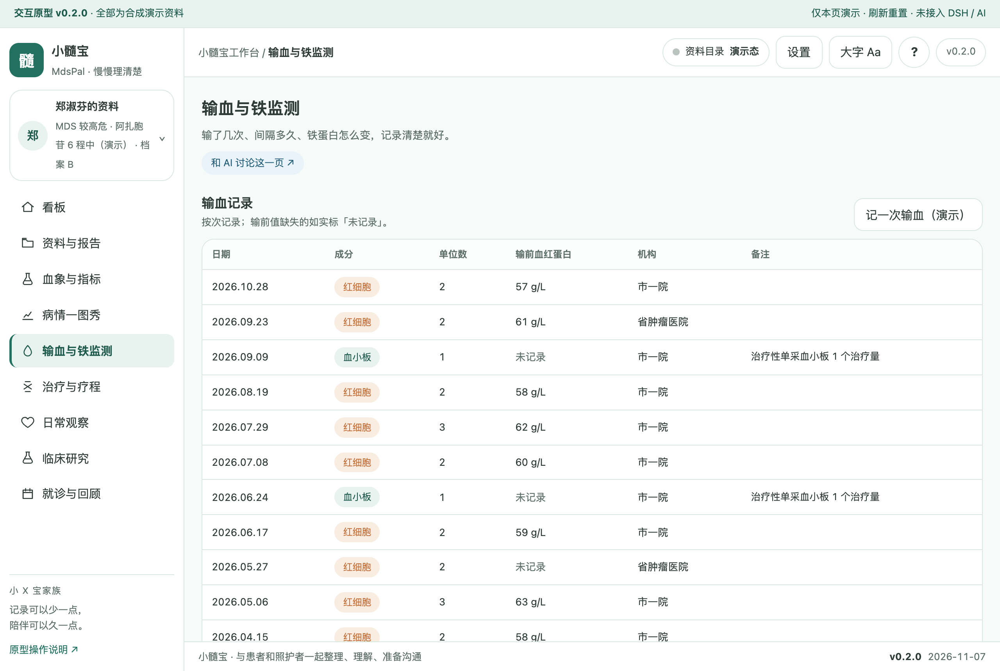
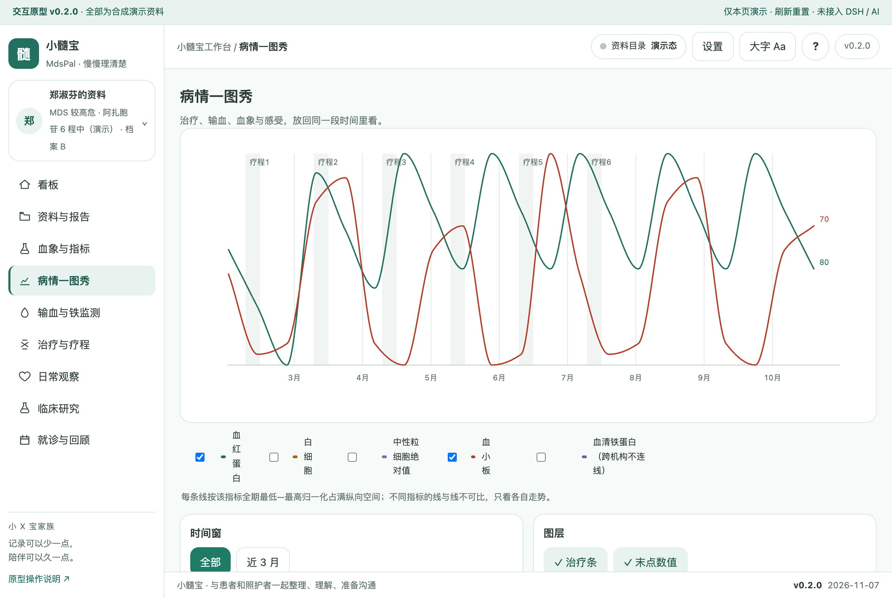
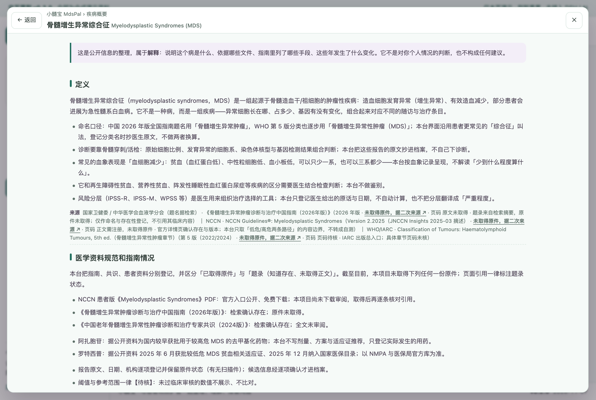

# 小髓宝 MdsPal 骨髓增生异常综合征工作台（品牌占位）

面向 MDS 患者与家属照护者的本机病程工作台：确诊依据登记、血象随访、输血与铁监测、疗程折叠、日常观察医嘱原话、就诊准备。**v0.2.0 为 HTML 交互原型（合成演示数据），未接入 DSH / AI / 云端解析，未实现真实业务。**

## 疾病概要

> 整体属解释层：只整理公开信息，不判断你的病情。顶栏「?」可打开四段整页浮窗（定义 → 医学资料规范和指南情况 → 治疗全景 → 发展趋势），每段带来源行；全部来源为题录（未取得原件，据二次来源），验收探针 `node scripts/probe-disease-primer.mjs --url http://127.0.0.1:8124/prototypes/v0.2/index.html` 10/10。

### 定义

骨髓增生异常综合征（myelodysplastic syndromes，MDS）是一组起源于骨髓造血干/祖细胞的肿瘤性疾病：造血细胞发育异常、有效造血减少，部分患者会进展为急性髓系白血病。诊断靠骨髓穿刺/活检、染色体与基因检测组合判断——本台把这些报告原文抄进档案，不下诊断。风险分层（IPSS-R 等）只登记医生原话，不自动计算。命名口径：中国 2026 年版全国指南题名用「骨髓增生异常肿瘤」，本台界面沿用「综合征」，登记时抄医生原文。

### 医学资料规范和指南情况

NCCN MDS 临床版 v2.2025（题录，正文未取得）、NCCN 患者版 PDF（入口公开，未下载未审阅）、《骨髓增生异常肿瘤诊断与治疗中国指南（2026年版）》（题录）、老年 MDS 专家共识 2024（题录）；药品题录（阿扎胞苷/罗特西普）以 NMPA 官方库为准，夜间窗口未复核。台账：[docs/SOURCES.md](docs/SOURCES.md)。

### 目前治疗全景概要

按「观察随访 / 输血与支持 / 药物治疗（去甲基化等，按实际用药登记）/ 造血干细胞移植评估前材料整理」四类登记手段名称；本台不构成任何一项适合你的判断，需要问你的医生；病程按病期与线序排列（家族肿瘤口径）。

### 发展趋势

只登记已发生事实——罗特西普 2025-06 获 NMPA 批准、2025-12 入国家医保（据公开报道，官方库未复核）；NCCN MDS 2025-03 更新至 v2.2025；中国指南 2026 年版发布（题录）。不预测、不承诺。

**来源**：NCCN MDS v2.2025 · 题录（正文未取得）｜《骨髓增生异常肿瘤诊断与治疗中国指南（2026年版）》· 题录 ｜ NCCN 患者版 PDF · 未下载未审阅 ｜ 完整台账见 [docs/SOURCES.md](docs/SOURCES.md)。

## 关键功能（截图墙）

**看板：输血节奏 + 整页视图入口 + 感受/指标并置**（档案 A 低危初诊）

首屏是「现在到哪一步了」与近 90 天输血节奏；报告、化验、大图都开整页，不塞弹窗。

**两套合成档案切换：A 记录少 / B 记录多**

切换后整页数据联动不串档；B 档案展示高危治疗路径的完整形态。

**血象指标卡：194px 定高 3D 翻转**

正面是最近值/较上次/次数/来源；背面是走势——跨机构只画点不连线。

**治疗与疗程：一次疗程一张折叠卡（收/展两态）**


收起看进度与最低点，展开看每天记录；计次与演示数据逐条对账一致。

**输血与铁监测：只对照、不解读**

铁蛋白趋势与累计输血量并排展示；因果与处置问医生。

**病情一图秀：治疗条与数据线分层**

每条线按该指标全期归一化（线与线不可比）；单点不连线、空窗口给空态。

**疾病概要：顶栏 ？ 整页四段**

「返回」与「关闭」两个独立入口；Esc 退一层；关闭后焦点回到触发按钮。

## 怎么用

双击打开 `prototypes/v0.2/index.html`（file:// 可直接运行；或 `python3 -m http.server` 后访问）。左侧切换 9 条一级线；顶栏「?」开疾病概要；「档案」按钮切换 A/B 两套合成演示；指标卡点按翻面。所有数据为合成演示，刷新重置。

## 数据与口径

- 演示数据唯一源：`demo/build-demo-data.mjs` 生成 `demo/demo-data.json` 与 `prototypes/v0.2/demo-data.js`（两份逐字一致）；页面不写死数字。
- 隐私：「家属记录」默认私密，看板提醒 / 导出 / AI 上下文三处共用同一过滤函数，页内标注「N 条中私密 M 条」。
- 医学红线：不做诊断/危险分层/治疗建议；阈值与参考范围一律【待核】；0 患者访谈、0 临床审核如实标注。
- 试验线按 35 号三步（建档→检索→匹配结果）：三态字段对照、无匹配指数、无判读列、状态未核实以官方库为准。

## 开发

```bash
npm run check        # 静态合同 + 探针覆盖 + 版本 + primer 链接（全绿）
npm test             # 单测
node demo/build-demo-data.mjs                                  # 重新生成演示数据
node scripts/probe-disease-primer.mjs --url http://127.0.0.1:8124/prototypes/v0.2/index.html   # P1–P9（10/10）
node scripts/probe-page-view.mjs --url http://127.0.0.1:8123/prototypes/v0.2/index.html        # A1–A10（13/13）
node scripts/probe-mds-checks.mjs                              # C/MT/Q 证据（27/27）
node scripts/capture-shots.mjs                                 # 重新截图（版本号入文件名）
```

文档：[SPEC](docs/SPEC.md) · [DEV-PLAN](docs/DEV-PLAN.md) · [DIFF-MATRIX](docs/DIFF-MATRIX.md) · [SCENARIOS](docs/SCENARIOS.md) · [CLINICAL-DATA](docs/CLINICAL-DATA.md) · [INTERACTION-DESIGN](docs/INTERACTION-DESIGN.md) · [PROGRESS](PROGRESS.md)。认领：[Issue #63](https://github.com/xyb-openharness-dsh-plugins/.github/issues/63)。
